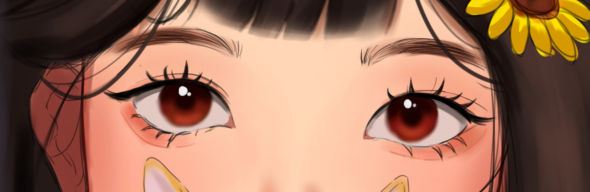

<!--Banner-->

<!--Illustration-->

  

<!--Header Name-->
#  ɪ'ᴍ ᴋᴇʟᴍᴀ!
*Digital Craftsman (Developer / Programmer / Artist)*
 

<!--Start Intro-->

I'm Abdul Malik Gampong, a 22-year-old self-taught developer. I build websites, mobile apps, and games, using AI tools along the way to help me design, code faster and being part of my development process.

- ✨ Student of life
- 🌱 I’m currently learning many things, I believe that everyday is a learning opportunity.
- 🎮 Building **ISO Pet Mining**, an isometric pet mining game made with Godot 4 and C# (.NET 8).
- 🧩 I like writing clean code and creating fun projects that people can actually use.
- 💻 Visit my [repositories](https://github.com/kelmaxxx?tab=repositories) for more details about me.
<!--End Intro-->

<!--Profile Count Badge-->

  

---

<!--Languages and Tools Section-->
<h2 align="center">Tᴇᴄʜ sᴛᴀᴄᴋ</h2>

  

 

<h3 align="left">Current Learning</h3>
<ul align="left">
  <li>Getting comfortable with Godot 4 and C# for game development.</li>
  <li>Learning pixel art and isometric level design.</li>
  <li>Improving my skills in building websites and mobile apps.</li>
</ul>
 

---

<!--Github Stats-->
<h2 align="center">📊 Gɪᴛʜᴜʙ Sᴛᴀᴛs 📊</h2>

  

Generated with <a href="https://github.com/lowlighter/metrics">lowlighter/metrics</a>
 

---

<!--Contact Section-->
<h2 align="center">🤝 Cᴏɴɴᴇᴄᴛ Wɪᴛʜ Mᴇ 🤝</h2>

  
  

